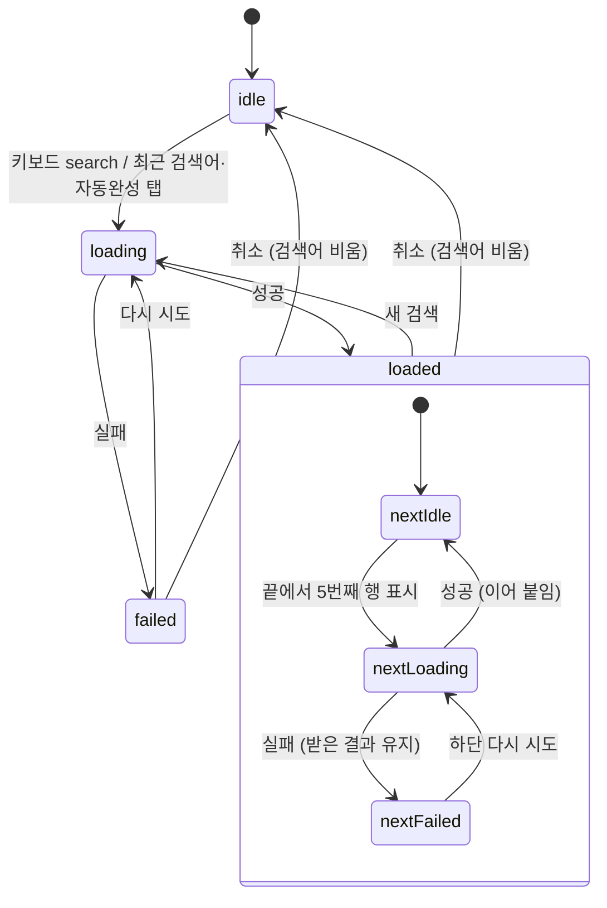
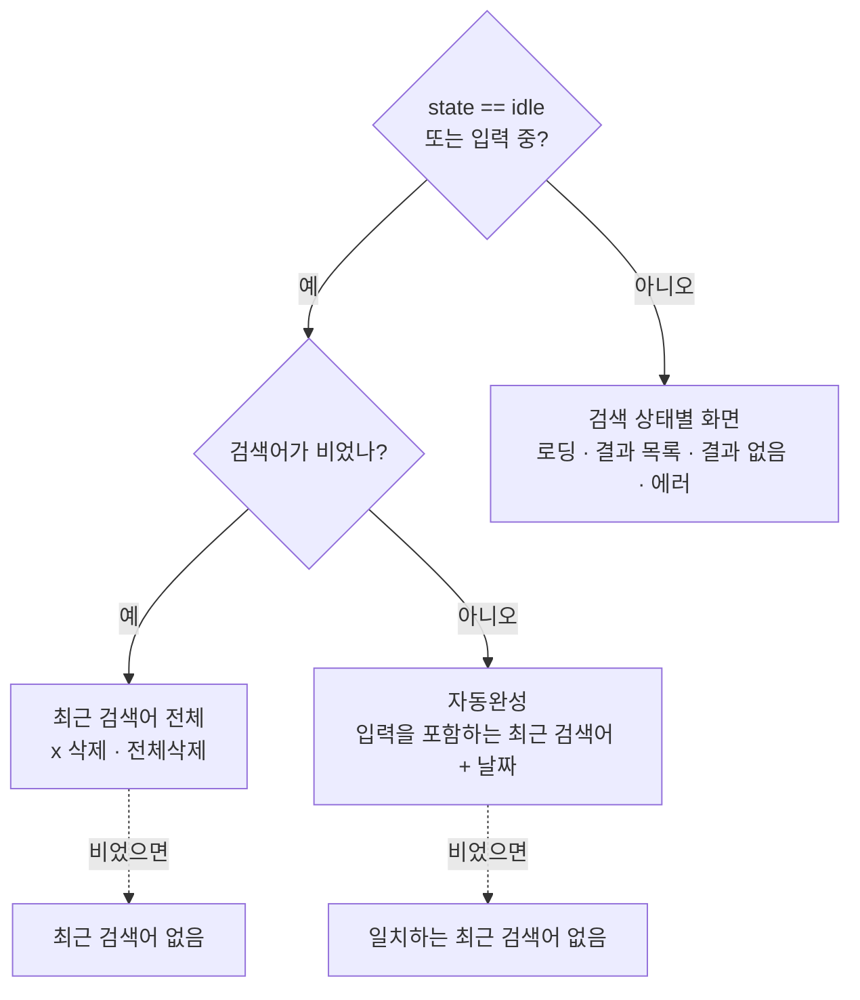
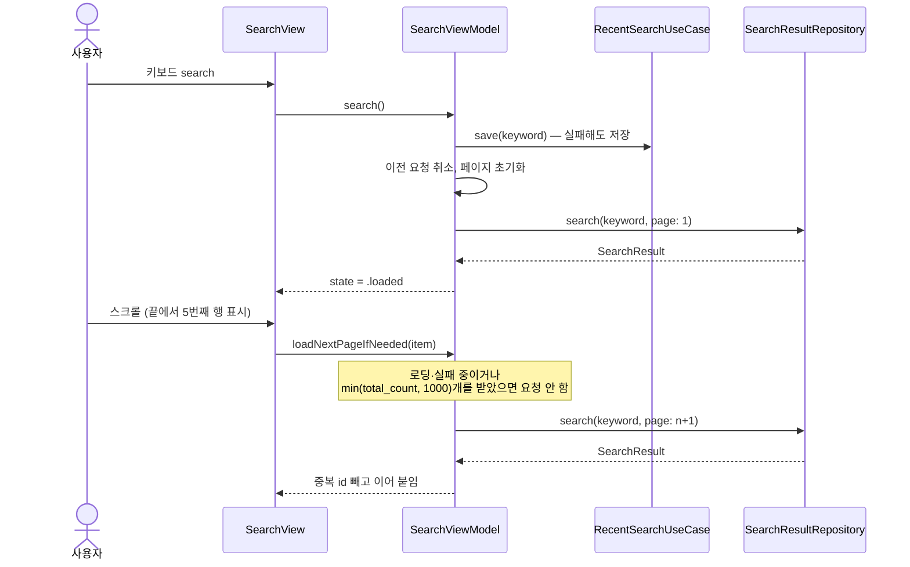

# Kurly_Project

GitHub 저장소 검색 앱 — 최근 검색어 · 자동완성 · 검색 결과(페이지네이션) · 저장소 WebView

| 항목 | 내용 |
|---|---|
| UI | SwiftUI (iOS 17.0+, iPhone) |
| 비동기 | Swift Concurrency (async/await) |
| 아키텍처 | Clean Architecture (Presentation / Domain / Data) + MVVM |
| 저장 | UserDefaults + Codable |
| 테스트 | XCTest 단위 테스트 72개 |
| 외부 라이브러리 | 없음 |
| 개발 환경 | Xcode 27.1 |

## 주요 기능

- **최근 검색어**: 최대 10개, 마지막 검색 시각 기준 최신순, 개별·전체 삭제, 앱 재시작 후에도 유지
- **자동완성**: 입력할 때마다 최근 검색어 중 입력을 포함하는 항목을 마지막 검색 날짜와 함께 표시
- **검색 결과**: 총 개수, 썸네일·저장소 이름·소유자, 끝에 닿기 전에 다음 페이지 미리 불러오기
- **저장소 상세**: 결과를 누르면 GitHub 저장소 페이지를 WebView로 표시
- **에러 처리**: 네트워크 없음 / 요청 한도 초과 / 그 외를 나눠 안내하고 다시 시도

## 아키텍처

```mermaid
flowchart TB
    subgraph P["Presentation"]
        direction LR
        SV["SearchView"] --> VM["SearchViewModel<br/>@Observable"]
        SV --> WV["SearchDetailWebView<br/>WKWebView"]
    end

    subgraph D["Domain"]
        direction LR
        RP1[["SearchResultRepository<br/>protocol"]]
        UC["RecentSearchUseCase<br/>중복 · 정렬 · 10개 제한 · 자동완성"] --> RP2[["RecentSearchRepository<br/>protocol"]]
        EN["Entity · SearchError"]
    end

    subgraph DA["Data"]
        direction LR
        DR1["DefaultSearchResultRepository"] --> API["GitHubSearchAPIClient"] --> HC[["HTTPClient<br/>URLSession"]]
        DR2["UserDefaultsRecentSearchRepository<br/>RecentSearchDTO"]
    end

    VM -->|"검색 (단순 위임)"| RP1
    VM -->|"최근 검색어 정책"| UC
    RP1 <-. 구현 .- DR1
    RP2 <-. 구현 .- DR2
```

- 의존 방향은 **Presentation → Domain ← Data**. Domain은 다른 레이어를 모르고, Data가 Domain의 프로토콜을 구현한다.
- `Util/`에는 화면 문구(`SearchError+Message`)와 키보드 내리기(`UIApplication+EndEditing`) 확장을 둔다.
- 검색은 도메인 로직이 없는 단순 위임이라 ViewModel이 Repository를 직접 호출한다. 최근 검색어는 정책이 있어 UseCase를 거친다.
- Repository와 `HTTPClient`를 프로토콜로 두어 테스트에서 Mock·InMemory 구현으로 바꿔 끼운다.

## 화면 상태



화면에 무엇을 보여줄지는 검색 상태와 **입력 중(키보드가 올라와 있는지)** 으로 정한다.



## 검색 · 페이지네이션 흐름



## 에러 처리

| 상황 | `SearchError` | 화면 |
|---|---|---|
| 연결 실패 | `network` | "인터넷에 연결되어 있지 않습니다" + 다시 시도 |
| 429, 또는 `x-ratelimit-remaining: 0`·`retry-after`가 있는 403 | `rateLimited` | "요청이 너무 많습니다" + 다시 시도 |
| 디코딩 실패, 그 외 상태 코드 | `decoding` · `unexpectedStatus` | "검색 결과를 불러오지 못했습니다" + 다시 시도 |
| 요청 취소 (새 검색) | `cancelled` | 화면에 나타내지 않음 |
| 다음 페이지 실패 | 위와 같음 | 받은 결과 유지, 목록 하단에 안내 + 다시 시도 |
| WebView 첫 로드 실패 | — | 에러 화면 + 다시 시도 (링크 연타로 인한 취소는 무시) |

## 주요 구현 결정

| 영역 | 결정 |
|---|---|
| 최근 검색어 | 중복은 대소문자 무시로 판정하고, 새 표기와 시각으로 갱신 (개수가 늘지 않음) |
| | 저장 자체를 10개로 제한, 넘치면 가장 오래된 항목 삭제 |
| | 검색을 실행한 순간 저장 (검색이 실패해도 저장), 앞뒤 공백은 trim |
| 자동완성 | 포함(contains) 매칭, 대소문자 무시. 입력 중에는 네트워크 요청 없음 |
| | 날짜는 앱 언어와 무관하게 `yy. MM. dd.` 형식 |
| 입력 중 판단 | iOS 17에는 검색바 포커스 API(`.searchFocused`, iOS 18+)가 없어 키보드 표시 알림으로 판단 |
| 검색 결과 | 총 개수는 API `total_count`를 그대로 표시, 한 페이지는 API 기본값 30개 |
| 페이지네이션 | 끝에서 5번째 행이 보이면 미리 요청. GitHub 검색 한도(1,000개)와 빈 페이지에서 중단 |
| | 페이지 사이 중복 저장소는 `id`로 제외. 새 검색 시 이전 다음 페이지 요청 취소 |
| 동시성 | 새 검색 시 이전 요청을 취소하고, 늦게 온 결과가 최신 결과를 덮어쓰지 않게 막음 |

## 폴더 구조

```
KurlyProject/
├── KurlyProject/
│   ├── Domain/
│   │   ├── Entity/        GitHubRepository, RecentSearch, SearchResult
│   │   ├── Repository/    SearchResultRepository, RecentSearchRepository (프로토콜)
│   │   ├── UseCase/       RecentSearchUseCase
│   │   └── SearchError.swift
│   ├── Data/
│   │   ├── DTO/           SearchResultDTO, RecentSearchDTO
│   │   ├── Network/       HTTPClient, GitHubSearchAPIClient
│   │   └── Repository/    DefaultSearchResultRepository, UserDefaultsRecentSearchRepository
│   ├── Presentation/      SearchView, SearchViewModel, SearchDetailWebView
│   ├── Util/              SearchError+Message, UIApplication+EndEditing
│   └── KurlyProjectApp.swift
└── KurlyProjectTests/     단위 테스트 + Resources(실제 응답 기반 JSON 픽스처)
docs/ai/                   AI 활용 기록
```

## 테스트

| 대상 | 개수 | 확인하는 것 |
|---|---|---|
| `SearchViewModelTests` | 31 | 검색 상태 전환, 최근 검색어 저장, 다시 시도, 취소 시 idle, 늦게 온 결과 무시, 페이지네이션 |
| `GitHubSearchAPIClientTests` | 14 | 요청 URL·인코딩, 상태 코드·헤더별 에러 매핑, 취소와 네트워크 에러 구분 |
| `RecentSearchUseCaseTests` | 12 | 중복 갱신, 정렬, 10개 제한, 삭제, 자동완성 필터 |
| `SearchResultDTOTests` | 6 | 실제 응답 픽스처 디코딩, Entity 변환, 필수 키 누락 시 실패 |
| `UserDefaultsRecentSearchRepositoryTests` | 4 | 저장·복원·덮어쓰기, 읽을 수 없는 데이터는 빈 목록 |
| `DefaultSearchResultRepositoryTests` | 3 | API 결과의 Domain 변환, 빈 결과, 에러 전달 |
| `SearchErrorMessageTests` | 2 | 에러별 안내 문구 구분 |

```bash
xcodebuild -project KurlyProject/KurlyProject.xcodeproj -scheme KurlyProject \
  -destination 'platform=iOS Simulator,name=iPhone 16 Pro' \
  test
```

시뮬레이터 이름은 설치된 기기에 맞게 바꾼다. Xcode에서는 ⌘U로 실행한다.

## 알려진 동작

- 검색 후 검색어를 고치고 검색하지 않은 채 키보드만 내리면, 고친 검색어 아래에 이전 결과가 그대로 보인다.
- 검색 결과 목록 아래의 빈 공간을 눌러서는 키보드가 내려가지 않는다 (스크롤하면 내려간다).
- 하드웨어 키보드 연결 시에는 키보드 표시 알림이 오지 않을 수 있어 자동완성 전환이 다르게 동작할 수 있다 (미확인).

## AI 활용

생성형 AI(Claude Code)를 설계 논의·코드·테스트·문서에 활용했다. 어디에 AI를 썼고 어디를 직접 판단했는지는 [docs/ai/README.md](docs/ai/README.md)와 작업별 기록 [docs/ai/logs/](docs/ai/logs/)에 정리했다. AI에게 적용한 작업 규칙은 [CLAUDE.md](CLAUDE.md)에 있다.
